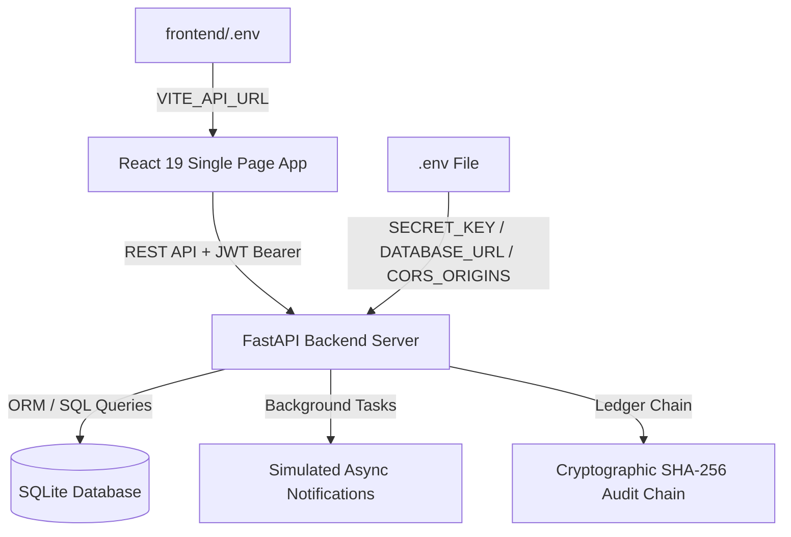

# Campus Resource Booking & Access Control Platform

A modern, multi-tenant campus resource booking and scheduling system built with **FastAPI**, **SQLAlchemy**, and **React 19 (Vite)**. Features tenant isolation across university departments, role-based access control (RBAC), conflict-free interval scheduling, asynchronous alerts, and a cryptographic SHA-256 tamper-evident audit ledger.

---

## Architecture Overview



### Core Highlights

- **Multi-Tenant Logical Isolation**: Separate data partitions and themed UI for different campus departments (e.g., *School of Computing*, *Department of Athletics*).
- **Role-Based Access Control (RBAC)**:
  - **Administrator**: Approve/reject requests, manage resources, view & verify cryptographic audit logs, simulate/repair tamper scenarios.
  - **Faculty**: Instant auto-approved bookings and schedule viewing.
  - **Student**: Pending booking requests requiring administrative approval.
- **Privilege Escalation Prevention**: Self-registration is restricted to `Student` and `Faculty` roles only. The `Admin` role cannot be self-assigned and must be seeded or granted by an existing administrator.
- **Environment-Driven Configuration**: All secrets (`SECRET_KEY`), database URLs, and CORS origins are loaded from `.env` files — never hardcoded.
- **Interval Overlap Conflict Engine**: Prevents double-booking using rigorous interval math (`start_time < existing_end` and `end_time > existing_start`).
- **Cryptographic Audit Ledger**: Every major state change (registration, resource creation, booking approval/rejection/cancellation) is chained using sequential SHA-256 hashing. Includes real-time tamper detection and blockchain-style chain verification.
- **Asynchronous Notifications**: Background tasks dispatch simulated in-app alerts on status changes and administrative actions.

---

## Repository Structure

```
campus-booking-platform/
├── .gitignore               # Prevents secrets (.env) and DB files from being committed
├── README.md                # Project documentation (this file)
├── backend/
│   ├── .env                 # ⚠️ Local secrets — NOT committed to git
│   ├── .env.example         # Template for environment variables
│   ├── audit.py             # Cryptographic hash chaining & integrity verification
│   ├── auth.py              # JWT tokens, bcrypt password hashing, & role dependencies
│   ├── campus_booking.db    # SQLite database (auto-generated, NOT committed to git)
│   ├── conflict.py          # Booking interval overlap conflict detection logic
│   ├── database.py          # SQLAlchemy engine & session setup (DATABASE_URL from env)
│   ├── main.py              # FastAPI application endpoints, routing, & seeding
│   ├── models.py            # SQLAlchemy database schemas
│   ├── requirements.txt     # Pinned Python backend dependencies
│   └── test_backend.py      # Automated unit test suite
└── frontend/
    ├── .env                 # ⚠️ Local config — NOT committed to git
    ├── .env.example         # Template for frontend environment variables
    ├── public/              # Static assets (favicon, icons)
    ├── src/
    │   ├── App.jsx          # Main application component & tab views
    │   ├── index.css        # Theme variables, glassmorphism UI, & responsive styles
    │   └── main.jsx         # React application entry point
    ├── index.html           # HTML template
    ├── package.json         # Node.js frontend dependencies & scripts
    └── vite.config.js       # Vite build configuration
```

---

## Prerequisites

- **Python**: 3.9+
- **Node.js**: 18.x or higher
- **npm** or a compatible package manager

---

## Getting Started

### 1. Backend Setup

1. Open a terminal and navigate to the `backend/` directory:
   ```bash
   cd backend
   ```

2. Create and activate a Python virtual environment (recommended):
   ```bash
   # Windows (PowerShell)
   python -m venv venv
   .\venv\Scripts\Activate.ps1

   # Linux / macOS
   python3 -m venv venv
   source venv/bin/activate
   ```

3. Install required Python packages:
   ```bash
   pip install -r requirements.txt
   ```

4. **Configure environment variables** — copy the example file and edit it:
   ```bash
   cp .env.example .env
   ```
   Open `backend/.env` and set a strong `SECRET_KEY`. You can generate one with:
   ```bash
   python -c "import secrets; print(secrets.token_hex(32))"
   ```
   > ⚠️ **Never commit `backend/.env` to version control.** It is listed in `.gitignore`.

5. Run the FastAPI development server:
   ```bash
   uvicorn main:app --reload --host 127.0.0.1 --port 8000
   ```
   The backend will automatically seed initial tenants, demo users, and sample resources on first startup.

   - **Interactive API Docs (Swagger UI)**: [http://127.0.0.1:8000/docs](http://127.0.0.1:8000/docs)
   - **Alternative Docs (ReDoc)**: [http://127.0.0.1:8000/redoc](http://127.0.0.1:8000/redoc)

---

### 2. Frontend Setup

1. Open a second terminal and navigate to the `frontend/` directory:
   ```bash
   cd frontend
   ```

2. **Configure environment variables** — copy the example file:
   ```bash
   cp .env.example .env
   ```
   The default `VITE_API_URL=http://127.0.0.1:8000/api` works for local development out of the box.

3. Install Node dependencies:
   ```bash
   npm install
   ```

4. Start the Vite development server:
   ```bash
   npm run dev
   ```
   - **Frontend Application URL**: [http://localhost:5173](http://localhost:5173)

---

## Environment Variables Reference

### Backend (`backend/.env`)

| Variable | Required | Default | Description |
| :--- | :---: | :--- | :--- |
| `SECRET_KEY` | ✅ Yes | — | JWT signing secret. Must be a strong, random hex string. |
| `ACCESS_TOKEN_EXPIRE_MINUTES` | No | `120` | JWT token lifetime in minutes. |
| `DATABASE_URL` | No | `sqlite:///./campus_booking.db` | SQLAlchemy database connection URL. |
| `CORS_ORIGINS` | No | `http://localhost:5173,http://127.0.0.1:5173` | Comma-separated list of allowed frontend origins. |

### Frontend (`frontend/.env`)

| Variable | Required | Default | Description |
| :--- | :---: | :--- | :--- |
| `VITE_API_URL` | No | `http://127.0.0.1:8000/api` | Base URL of the FastAPI backend API. |

---

## Demo Accounts & Default Credentials

The database is pre-seeded with sample users across both departments:

| Tenant / Department | Role | Username | Password |
| :--- | :--- | :--- | :--- |
| **School of Computing** (`computing`) | Administrator | `admin_comp` | `admin123` |
| **School of Computing** (`computing`) | Faculty | `fac_comp` | `faculty123` |
| **School of Computing** (`computing`) | Student | `stud_comp` | `student123` |
| **Department of Athletics** (`athletics`) | Administrator | `admin_ath` | `admin123` |
| **Department of Athletics** (`athletics`) | Faculty | `fac_ath` | `faculty123` |
| **Department of Athletics** (`athletics`) | Student | `stud_ath` | `student123` |

> [!TIP]
> The login screen includes quick preset buttons to automatically switch departments and pre-fill credentials for fast testing.

> [!IMPORTANT]
> Self-registration is restricted to **Student** and **Faculty** roles only. Administrator accounts must be seeded (as above) or created directly in the database. This prevents privilege escalation attacks.

---

## Role Capabilities

| Capability | Student | Faculty | Administrator |
| :--- | :---: | :---: | :---: |
| Browse department resources | ✅ | ✅ | ✅ |
| Submit booking requests | ⏳ Pending approval | ✅ Auto-approved | ✅ Auto-approved |
| Cancel own bookings | ✅ | ✅ | ✅ |
| Cancel any booking | ❌ | ❌ | ✅ |
| Approve / reject student requests | ❌ | ❌ | ✅ |
| Add new campus resources | ❌ | ❌ | ✅ |
| View cryptographic audit ledger | ❌ | ❌ | ✅ |
| Verify & repair audit chain | ❌ | ❌ | ✅ |
| Self-register via signup form | ✅ | ✅ | ❌ |

---

## Key Features & User Guide

### 1. Resource Catalog & Dynamic Booking
- Browse facilities (Labs, Seminar Halls, Sports Courts, Research Equipment) scoped to the active tenant.
- Select date, start time, and end time to submit booking requests.
- Immediate conflict checking alerts users if an overlapping booking is present.

### 2. Live Schedule & Timeline View
- Table view showing all department bookings with status badges.
- Status indicators: `Approved` (Green), `Pending` (Amber), `Rejected` (Red), `Cancelled` (Gray).
- Administrators can directly approve or reject pending student requests from the dashboard.
- An 8-second polling interval keeps the schedule in sync across sessions.

### 3. Asynchronous Notifications Drawer
- All booking state changes (creation, approval, rejection, cancellation) trigger background notifications.
- Administrators receive alerts when new student requests are submitted in their department.
- Notifications are per-user and per-tenant, visible in the **Inbox Alerts** tab.

### 4. Cryptographic Audit Ledger (Admin Only)
Every state action produces a SHA-256 hash incorporating the previous entry's hash:

$$\text{Hash}_n = \text{SHA256}(\text{PrevHash} \parallel \text{Timestamp} \parallel \text{TenantID} \parallel \text{UserID} \parallel \text{Action} \parallel \text{Details})$$

- **Verify Chain**: Evaluates the integrity of all hash links and reports the exact block where tampering occurred.
- **Simulate Tamper**: Injects unauthorized modifications into database records without updating hashes to demonstrate fraud detection.
- **Repair Chain**: Re-computes and re-signs the entire ledger chain.

---

## Security Notes

> [!WARNING]
> The following security practices are enforced in this codebase. Review them before any deployment.

| Concern | Implementation |
| :--- | :--- |
| **Secret key** | Loaded from `SECRET_KEY` env variable. Server refuses to start if unset. |
| **Password hashing** | bcrypt via `passlib[bcrypt]` — an adaptive, salted hashing algorithm. |
| **Admin self-registration** | Blocked at the API level (HTTP 403). Only `Student` and `Faculty` can self-register. |
| **CORS** | Restricted to origins listed in `CORS_ORIGINS` env variable. Not `*`. |
| **Tenant isolation** | All queries are scoped by `tenant_id` extracted from the JWT — users cannot access cross-tenant data. |
| **JWT expiry** | Configurable via `ACCESS_TOKEN_EXPIRE_MINUTES` (default: 120 min). |
| **.gitignore** | `.env` files and `*.db` database files are excluded from version control. |

---

## Running Backend Automated Tests

To run the backend test suite (testing tenant isolation, conflict prevention, RBAC enforcement, and audit ledger tamper verification):

```bash
cd backend
python -m unittest test_backend.py -v
```

The test suite covers:
- Multi-tenant data isolation (Computing users cannot see Athletics resources)
- Booking conflict prevention (409 on overlapping time slots)
- RBAC enforcement (Students cannot create resources or view audit logs)
- Cryptographic tamper detection (hash mismatch caught after direct DB modification)

---

## Tech Stack

| Layer | Technology |
| :--- | :--- |
| **Backend Framework** | [FastAPI](https://fastapi.tiangolo.com/) |
| **ORM** | [SQLAlchemy](https://www.sqlalchemy.org/) |
| **Auth** | Python-JOSE (JWT), Passlib / bcrypt |
| **Validation** | Pydantic v2 |
| **Server** | Uvicorn (ASGI) |
| **Database** | SQLite (zero-config local) |
| **Frontend Framework** | [React 19](https://react.dev/) + [Vite](https://vitejs.dev/) |
| **UI Icons** | [Lucide React](https://lucide.dev/) |
| **Styling** | Custom Glassmorphism CSS Design System |
| **Config** | python-dotenv (backend), Vite env vars (frontend) |
